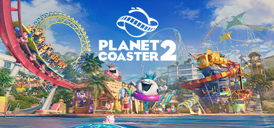

**Planet Coaster is the most creatively powerful theme park simulator ever made, featuring an extraordinary coaster builder tool with full 3D track placement and a deep piece-by-piece scenery system. Build parks of virtually unlimited complexity and beauty.**

---

## 📖 About

Planet Coaster is the most creatively powerful theme park simulator ever made, featuring an extraordinary coaster builder tool with full 3D track placement and a deep piece-by-piece scenery system. Build parks of virtually unlimited complexity and beauty.

## ⚠️ Problems Without Trainer

| Problem | Status |
|---------|--------|
| **Coaster Builder Mastery** — Creating smooth, exciting coasters requires understanding banking and forces | ✅ Solved |
| **Guest Pathfinding** — Poor path layouts in large parks cause guest navigation failures | ✅ Solved |
| **Financial Balance** — Keeping park profitable while expanding requires careful pricing strategy | ✅ Solved |
| **Performance Demands** — Detailed custom parks can push even high-end PCs to their limits | ✅ Solved |

## ✅ Solution

The **Planet Coaster Trainer** solves all these issues by giving you complete control over the game.

## 🎯 Full Feature List

- Unlimited Resources
- God Mode / Invincibility
- Instant Skill Cooldown
- One-Hit Kill
- Freeze Game Timer
- Unlock All Items & Achievements
- Custom Speed Multiplier
- Save State Anywhere

## 🚀 Quick Start

1. **Disable Windows Defender** temporarily (trainer may trigger false positive)
2. Download the trainer from the button above
3. Launch Planet Coaster
4. Run the trainer as Administrator
5. Activate desired cheats with hotkeys

## 💎 Free vs Paid

| Feature | Free | Pro |
|---------|------|-----|
| Basic God Mode | ✅ | ✅ |
| Unlimited Resources | ✅ | ✅ |
| All Advanced Cheats | ❌ | ✅ |
| Auto-Updates | ❌ | ✅ |
| Priority Support | ❌ | ✅ |

## 💻 Requirements

- Windows 10/11 (64-bit)
- Planet Coaster (any version)
- .NET Framework 4.8+
- DirectX 11+

## 🍎 macOS

macOS users can use our alternative tool:

## ⚖️ Legal

This trainer is for educational and single-player use only. Use responsibly.

---

